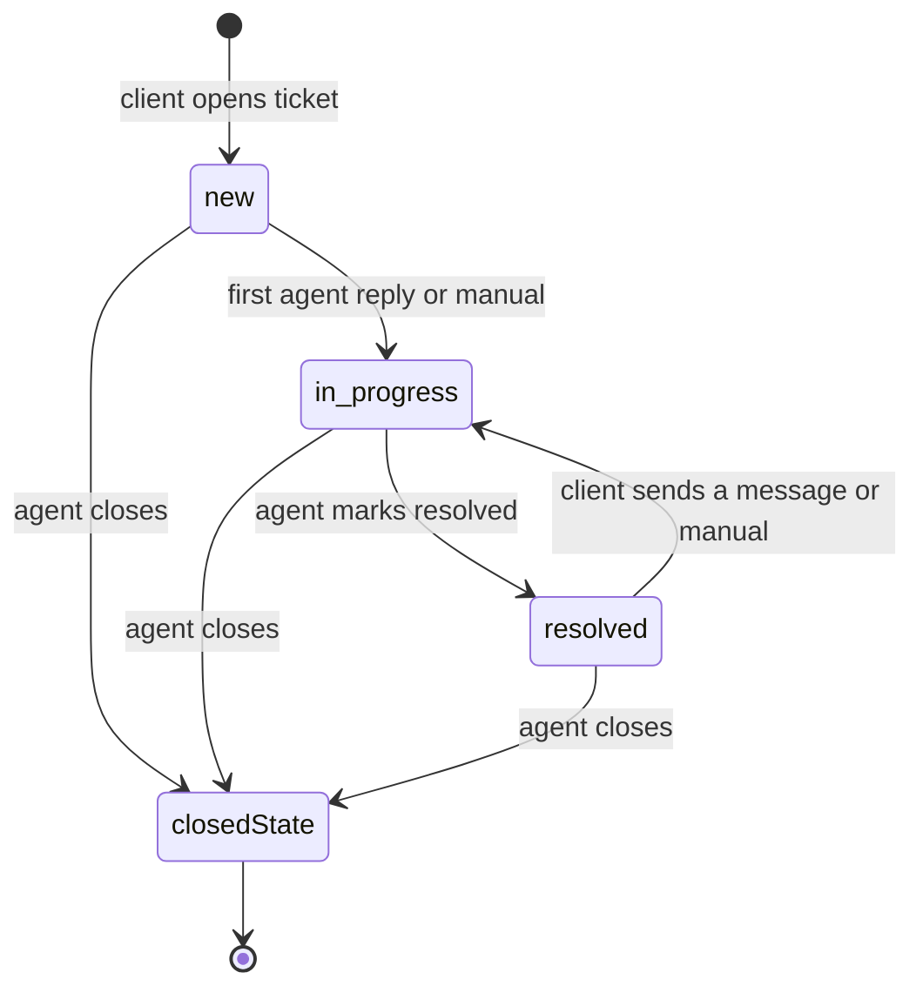

# Home Healers — Support Tickets API (Operations Dashboard)

Backend contract for the operations dashboard: the support agents who answer client tickets from the mobile app.

Agents are dashboard users (`users` table, same login as `POST /api/admin/login`). Any agent with the permission can reply. Tickets can optionally be assigned to an agent, but assignment does not lock out other agents.

---

## 1. Concepts

### Ticket status and stage

| Field | Values | Meaning |
|-------|--------|---------|
| `status` | `open`, `closed` | Closed tickets are read-only for both sides |
| `stage` | `new`, `in_progress`, `resolved` | Progress of the problem |

Stage transitions:



- `stage` keeps its last value after close (useful for reports: closed without resolution).
- There is no reopen. The client's next Contact Us creates a new ticket.

### Business rules

1. A client has at most **one open ticket**. A new ticket is created only when they have none open.
2. `number` is sequential (starts at `1001`). Display it as **Ticket No. {number}**.
3. Every new ticket starts with the **welcome message** from settings (section 6.13).
4. Only agents close tickets. The client can only **request** closing, which you then accept (close) or dismiss.
5. Agent messages store the agent's name and email at send time. The **client never sees them**. The app shows "Home Healer Support".
6. Several agents can reply on the same ticket.
7. Agents can soft-delete **their own** messages only. Client-deleted messages appear as tombstones without content.
8. Agent replies are shown to the client exactly as typed (not translated). System texts are bilingual.

---

## 2. Auth and permissions

| Header | Value |
|--------|-------|
| `Authorization` | `Bearer {admin token}` |
| `Accept` | `application/json` |
| `language` | `ar` / `en`. Affects labels and system message text |

Client tokens are rejected on these routes (`403`).

| Permission | Allows |
|------------|--------|
| `support_tickets` | View inbox, read tickets, reply, change stage, claim, dismiss close request |
| `support_tickets_assign` | Assign / unassign any agent |
| `support_tickets_close` | Close tickets |
| `support_tickets_settings` | Edit welcome message |

Envelope:

```json
{ "message": "Translated message", "data": { } }
```

Errors return `{ "message": "...", "error_code": "..." }`. Validation errors are Laravel's standard `422` with `message` + `errors`.

| HTTP | `error_code` | When |
|------|--------------|------|
| 403 | `forbidden` | Missing permission or non-staff token |
| 404 | `ticket_not_found` | |
| 422 | `ticket_closed` | Reply, stage change, assign, or close on a closed ticket |
| 422 | `invalid_stage_transition` | e.g. setting `new` |
| 422 | `no_close_request` | Dismissing when no request is pending |
| 403 | `cannot_delete_message` | Deleting a client message or another agent's message |
| 422 | `invalid_assignee` | Assigning to a user without `support_tickets` |
| 422 | `invalid_message` | `last_read_message_id` / message id is not in this ticket |
| 429 | — | Rate limit (messages 30/min, uploads 10/min per agent) |

---

## 3. Ticket resource (dashboard)

```json
{
  "id": 12,
  "number": 1001,
  "title": "Ticket No. 1001",
  "status": "open",
  "status_label": "Open",
  "stage": "in_progress",
  "stage_label": "In progress",
  "client": {
    "id": 55,
    "name": "Ahmed Ali",
    "mobile": "+9665xxxxxxx",
    "email": "ahmed@example.com",
    "locale": "ar"
  },
  "assignee": { "id": 3, "name": "Sara", "email": "sara@homehealers.com" },
  "assigned_at": "2026-10-10T08:05:00.000000Z",
  "participants": [
    { "id": 3, "name": "Sara", "email": "sara@homehealers.com", "messages_count": 4 }
  ],
  "close_requested": true,
  "close_requested_at": "2026-10-10T09:30:00.000000Z",
  "closed_at": null,
  "closed_by": null,
  "close_note": null,
  "unread_count": 2,
  "client_messages_count": 5,
  "client_last_read_message_id": 88,
  "first_response_at": "2026-10-10T08:07:00.000000Z",
  "resolved_at": null,
  "created_at": "2026-10-10T08:00:00.000000Z",
  "updated_at": "2026-10-10T09:30:00.000000Z",
  "last_message": {
    "id": 91,
    "type": "text",
    "preview": "Thanks, you can close it",
    "sender_type": "client",
    "is_deleted": false,
    "at": "2026-10-10T09:29:00.000000Z"
  }
}
```

| Field | Notes |
|-------|-------|
| `unread_count` | Client messages not yet read by **any** agent (shared team pointer) |
| `client_last_read_message_id` | Highest support message id the client has read. Use it to show "seen" on agent bubbles |
| `participants` | Agents who sent at least one message |
| `client_messages_count` | `0` means the client opened the ticket but never wrote |
| `close_note` | Internal only |

The list endpoint returns the same resource without `participants`.

---

## 4. Message resource (dashboard)

```json
{
  "id": 90,
  "ticket_id": 12,
  "sender_type": "support",
  "sender": { "id": 3, "name": "Sara", "email": "sara@homehealers.com" },
  "is_system": false,
  "system_event": null,
  "type": "text",
  "body": "We have rescheduled your session.",
  "metadata": null,
  "client_message_id": "uuid-or-null",
  "delivered_at": "2026-10-10T09:00:00.000000Z",
  "read_at": "2026-10-10T09:01:00.000000Z",
  "is_deleted": false,
  "deleted_at": null,
  "media_url": null,
  "created_at": "2026-10-10T09:00:00.000000Z"
}
```

| `sender_type` | `sender` |
|---------------|----------|
| `client` | `{ "id", "name" }` of the client |
| `support` (agent) | `{ "id", "name", "email" }` snapshot at send time. Still shown if the agent is later deleted |
| `support` (system) | `null`, with `is_system: true` and `system_event` set |

`system_event`: `welcome`, `close_requested`, `close_request_dismissed`, `resolved`, `closed`. `body` is in the request language, and `body_translations` (`{ "ar", "en" }`) is included for system messages only. Suggested UI: a centered line such as "Automatic welcome message".

Types: `text` (≤ 5000), `location` (`"lat,lng"`), `image`, `voice` (signed `media_url`, 60 min).

Deleted messages: `is_deleted: true`, `body: null`, `media_url: null`.

---

## 5. Inbox stats

`GET /api/admin/support-tickets/stats`

```json
{
  "data": {
    "open": 42,
    "new": 10,
    "in_progress": 25,
    "resolved": 7,
    "close_requested": 3,
    "unassigned": 12,
    "mine": 5,
    "unread_tickets": 9
  }
}
```

All counts are for open tickets. Use them for tab badges.

---

## 6. Endpoints

Base: `api/admin/support-tickets`

### 6.1 Realtime config

`GET .../config` (same shape as the mobile config).

### 6.2 List tickets

`GET .../`

| Query | Values | Default |
|-------|--------|---------|
| `status` | `open`, `closed`, `all` | `open` |
| `stage` | `new`, `in_progress`, `resolved` (comma-separated allowed) | all |
| `assigned` | `me`, `unassigned`, `{user_id}` | all |
| `close_requested` | `1` | — |
| `unread` | `1` (unread client messages) | — |
| `has_client_messages` | `1` / `0` | all (empty tickets are shown) |
| `client_id` | int | — |
| `search` | ticket number, client name, mobile, or email | — |
| `from`, `to` | `Y-m-d` on `created_at` | — |
| `sort` | `updated_at`, `created_at`, `number` (`-` prefix for desc) | `-updated_at` |
| `page`, `per_page` | per_page max 100 | 1, 20 |

```json
{
  "data": {
    "tickets": [],
    "meta": { "current_page": 1, "per_page": 20, "total": 42, "last_page": 3 }
  }
}
```

### 6.3 Ticket details

`GET .../{id}` returns the full ticket resource (with `participants`).

### 6.4 Client ticket history

Use `GET .../?client_id=55&status=all` to see a client's previous tickets.

### 6.5 List messages

`GET .../{id}/messages` with `cursor` and `limit` (default 30, max 50). Newest first, and `next_cursor` = older. Includes tombstones and system messages.

```json
{ "data": { "messages": [], "next_cursor": null, "prev_cursor": null } }
```

### 6.6 Mark client messages read

`POST .../{id}/read` with body `{}` (marks up to the latest client message) or `{ "last_read_message_id": 91 }`.

Call it when an agent opens a ticket and when a client message arrives while it is open. It sets `read_at` on client messages, moves the shared pointer, and resets `unread_count`. The client sees double checks.

### 6.7 Reply (text / location)

`POST .../{id}/messages`

```json
{ "type": "text", "body": "We have rescheduled your session.", "client_message_id": "optional-uuid" }
```

Effects:
- `422 ticket_closed` if closed.
- First agent reply sets `stage = in_progress` and `first_response_at`.
- Client gets realtime + push.
- `client_message_id` (optional) prevents duplicates on retry.

### 6.8 Reply (image / voice)

`POST .../{id}/messages/media` (`multipart/form-data`). Same fields and limits as mobile: `type`, `file`, `client_message_id`, `metadata[width|height|duration_seconds]`. Image ≤ 10 MB, voice ≤ 15 MB and ≤ 5 min.

### 6.9 Delete own message

`DELETE .../{id}/messages/{messageId}`. Own agent messages only. Returns the tombstone.

### 6.10 Change stage

`PATCH .../{id}/stage`

```json
{ "stage": "resolved" }
```

- Allowed targets: `in_progress`, `resolved`.
- `resolved` sets `resolved_at`, adds a `resolved` system message, and pushes `support_ticket_updated` to the client.
- Setting the current stage again: `200`, no change.

### 6.11 Assignment

| Endpoint | Body | Permission |
|----------|------|-----------|
| `POST .../{id}/claim` | `{}` | `support_tickets` (assigns to me) |
| `POST .../{id}/assign` | `{ "user_id": 3 }` or `{ "user_id": null }` to unassign | `support_tickets_assign` |

- The assignee must have the `support_tickets` permission.
- Assignment is internal: the client never sees it, and other agents can still reply.
- Closed ticket: `422 ticket_closed`.

`GET api/admin/support-tickets/agents` returns `[{ "id", "name", "email", "open_assigned_count" }]` for the assign dropdown.

### 6.12 Close and close requests

**Close**: `POST .../{id}/close` (permission `support_tickets_close`)

```json
{ "note": "Client confirmed issue solved" }
```

- `note` is optional, internal only.
- Sets `status = closed`, `closed_at`, `closed_by`, clears `close_requested`, and adds a `closed` system message ("This ticket has been closed. You can open a new ticket for help if you run into any problem.").
- Client: composer hidden (realtime) + push `support_ticket_updated`.
- Already closed: `422 ticket_closed`.

**Dismiss close request**: `POST .../{id}/close-request/dismiss` with body `{}`.

- Clears `close_requested` and adds a `close_request_dismissed` system message. The client can request again later.
- No pending request: `422 no_close_request`.

### 6.13 Settings (welcome message)

`GET api/admin/support-tickets/settings`
`PUT api/admin/support-tickets/settings` (permission `support_tickets_settings`)

```json
{
  "welcome_message": {
    "ar": "مرحبًا بك في الدعم الفني لـ Home Healers، كيف يمكننا مساعدتك؟",
    "en": "Welcome to Home Healers support. How can we help you?"
  }
}
```

- Both languages required, max 1000 chars each.
- Applies to **new** tickets only. Existing tickets keep their original welcome text.
- If never set, a built-in default is used.

### 6.14 Unread badge

`GET .../unread-count` returns `{ "data": { "unread_tickets": 9, "unread_messages": 14 } }`, counted on open tickets.

---

## 7. Realtime

Auth: `POST /api/broadcasting/auth` with the admin Bearer token. Requires `support_tickets`.

Realtime payloads have no request language. Labels (`stage_label`, `status_label`, system `body`) use the server's staff locale (`SUPPORT_TICKETS_STAFF_LOCALE`, default `ar`). Use `stage` / `status` / `body_translations` to localize yourself.

### Inbox channel: `private-support.inbox`

Subscribe on the tickets list page.

| Event | Payload | When |
|-------|---------|------|
| `support.inbox.updated` | Dashboard ticket resource (list shape) | Ticket created, new message (either side), stage / assignment / close-request / close change, read by agent |

Upsert the row by `id` and re-sort by `updated_at`. Refetch `stats` (or adjust locally).

### Ticket channel: `private-support.staff.ticket.{id}`

Subscribe on the open ticket screen.

| Event | Payload |
|-------|---------|
| `support.message.created` | Dashboard message resource (section 4), including tombstones and system messages |
| `support.messages.read` | `{ "ticket_id", "reader_role": "client" or "support", "last_read_message_id", "reader": { "id", "name" } or null }` |
| `support.ticket.updated` | Full dashboard ticket resource |

`reader_role = client` means the client read your replies (show "seen"). `reader_role = support` means another agent read the ticket, so clear your unread badge.

Typing indicators are not supported.

---

## 8. Agent flow summary

1. Inbox page: `GET stats` + `GET list?status=open`, then subscribe to `private-support.inbox`.
2. Open a ticket: `GET {id}` + `GET {id}/messages`, then `POST {id}/read`, then subscribe to `private-support.staff.ticket.{id}`.
3. Optionally `claim` it, or `assign` it to a colleague.
4. Reply with text / image / voice / location. The stage moves to `in_progress` automatically.
5. When solved: `PATCH stage = resolved`. If the client writes again, it goes back to `in_progress` automatically.
6. Client requested close (badge / filter `close_requested=1`): `close`, or `close-request/dismiss`.
7. Close with an optional internal note. The ticket becomes read-only.

## 9. Suggested UI

- Tabs: New · In progress · Resolved · Close requested · Mine · Unassigned · Closed.
- Row: `Ticket No.`, client name + mobile, stage chip, assignee, unread badge, last message preview, `updated_at`.
- Thread: client bubbles on one side; agent bubbles show the agent name; system messages as centered lines.
- Header actions: Claim / Assign · Stage dropdown · Close (with note) · Dismiss close request (only when requested).
- Side panel: client info + link to their previous tickets (`client_id` filter) + internal close note.
- Settings page: welcome message (ar / en).
